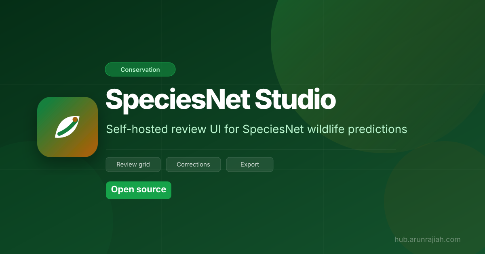
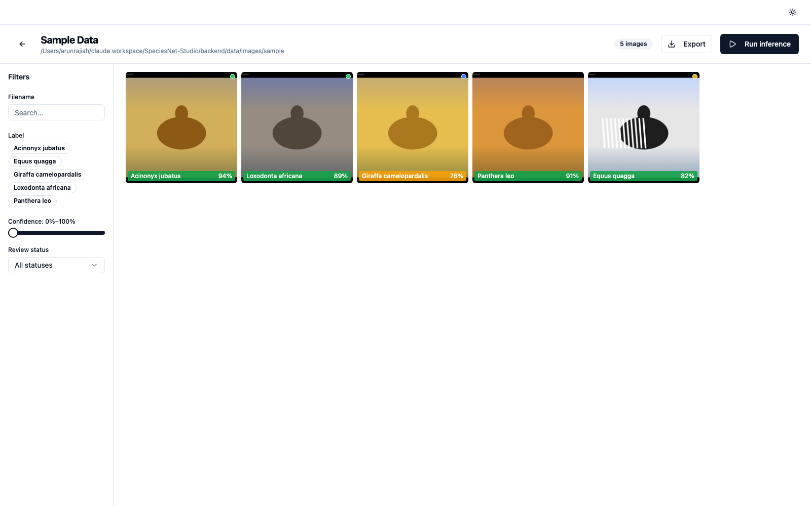
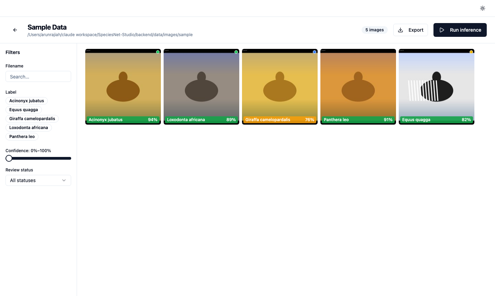
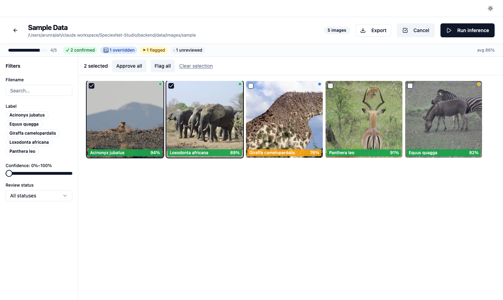
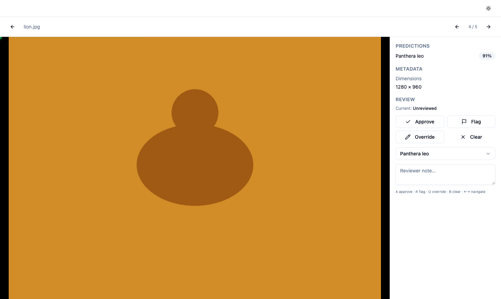
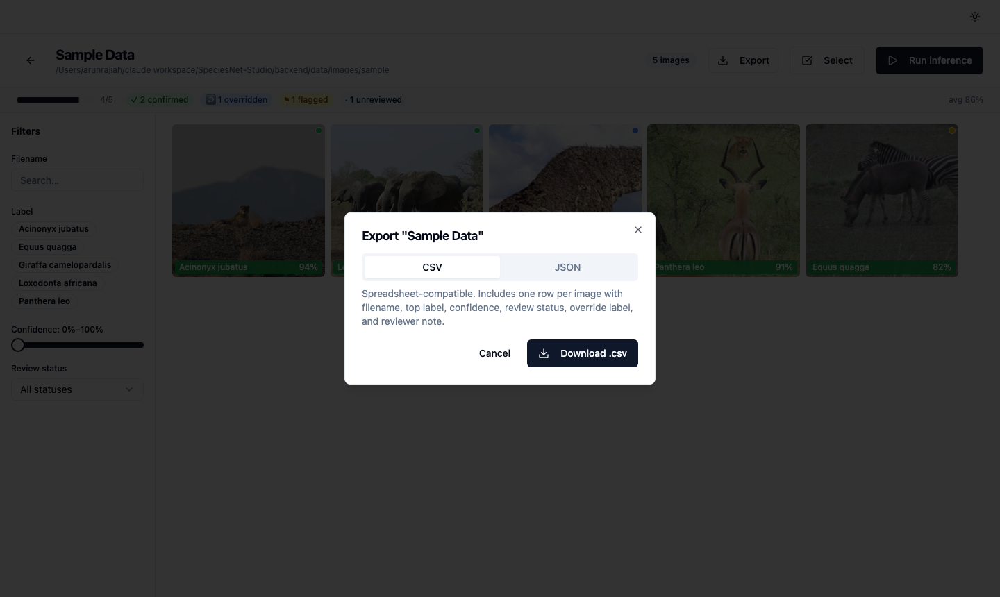

<p align="center">
  
</p>

<p align="center">
  
</p>

<div align="center">

# SpeciesNet Studio

**A self-hosted review UI for your SpeciesNet camera data.**

[](https://github.com/arunrajiah/speciesnet-studio/actions/workflows/ci.yml)
[](LICENSE)
[](https://github.com/arunrajiah/speciesnet-studio/releases)
[](https://github.com/arunrajiah/speciesnet-studio/pkgs/container/speciesnet-studio-backend)
[](https://github.com/sponsors/arunrajiah)

</div>



---

> Part of an open wildlife toolkit. Not sure this is the project you need? See [which project to use](#part-of-an-open-wildlife-toolkit).

## Why this exists

Camera trap programs routinely produce millions of images per season. Google's SpeciesNet is an excellent open-source classifier — but its output is a JSON blob, and getting a human reviewer through that blob efficiently requires tooling that doesn't exist yet. Researchers need a human-in-the-loop review UI that runs on their own hardware, keeps their data on-premise, and doesn't require a cloud account. SpeciesNet Studio fills that gap.

---

## Features

### Ingest
- Point Studio at any local folder; it walks subdirectories and imports every JPG, PNG, and TIF
- EXIF datetime and GPS coordinates extracted automatically
- 300 px thumbnails generated for fast gallery rendering

### Infer
- Native SpeciesNet adapter using the Python API (`pip install speciesnet`)
- Pluggable adapter protocol — swap in MegaDetector, a custom model, or any CLI tool
- Live WebSocket progress bar while inference runs in the background

### Review
- Virtualized thumbnail gallery — smooth at 10 000+ images
- Confidence badges colour-coded green / amber / red
- Bounding box canvas overlay on full-res detail view
- Keyboard-driven review: **A** approve · **O** override · **R** flag · **B** clear · **← →** navigate
- Sidebar filters: species, confidence range, review status, filename search
- Filter state synced to URL (bookmarkable, shareable)

### Export
- Download results as **CSV**, **JSON** or a **Wildlife Insights** CSV per collection
- **Share with Wildlife Network:** export reviewed results as [WDX](https://github.com/arunrajiah/wildlife-detection-exchange) events, or send them straight to the open [Wildlife Network](https://wlnw.org) map from the Export dialog (see [Sharing with Wildlife Network](#sharing-with-wildnetwork))

---

## Quickstart

```bash
git clone https://github.com/arunrajiah/speciesnet-studio
cd speciesnet-studio
docker compose up
```

Open [http://localhost:5173](http://localhost:5173) and click **"Try with sample data"** — no images required to get started.

---

## Using with your own data

**1. Put your images somewhere accessible**

```
/your/images/season-2024/
  ├── cam01/
  │   ├── IMG_0001.JPG
  │   └── ...
  └── cam02/
      └── ...
```

**2. Point Studio at that folder**

When creating a collection, enter the absolute path to your image root. Studio walks subdirectories automatically.

**3. Configure the inference adapter**

Edit `config/inference.yaml`:

```yaml
# Option A — native Python adapter (requires: pip install speciesnet)
adapter: speciesnet
speciesnet_country: KEN   # ISO-3166 code for geofencing, optional

# Option B — subprocess (any CLI tool that writes SpeciesNet-compatible JSON)
# adapter: subprocess
# adapter_command:
#   - python -m speciesnet.scripts.run_model
#   - --folders {folder}
#   - --predictions_json {output_json}
```

**4. Swap in a different model**

Implement the `InferenceAdapter` protocol (see [`backend/src/app/adapters/base.py`](backend/src/app/adapters/base.py)) and point the config at your adapter class. See [CONTRIBUTING.md](CONTRIBUTING.md) for details.

---

## Screenshots

| Gallery + stats | Batch review | Review detail | Export |
|-----------------|--------------|--------------|--------|
|  |  |  |  |

---

## Data privacy

Nothing leaves your machine unless you choose to share. Your images and predictions stay on your disk. Studio makes no network calls during normal operation. The exceptions: SpeciesNet downloads its model weights from Kaggle/HuggingFace on first run (SpeciesNet's own behaviour), and **Send to Wildlife Network** posts the records you choose, never the images.

## Sharing with Wildlife Network

Studio is where camera-trap results get checked by a person before anyone relies on them. Once a collection is reviewed, open **Export > Wildlife Network**:

1. Register the camera at [wlnw.org/contribute](https://wlnw.org/contribute) with source `speciesnet-studio` to get an API key.
2. Enter the camera's location (used for images without GPS) and its clock offset from UTC, for example `+05:30`.
3. Paste the key and press **Send to Wildlife Network**, or download the `.wdx.ndjson` file instead. With **Remember** ticked (the default), the key, location and clock offset are saved, so later sends are one click.
4. Optional: tick **Send each review to Wildlife Network automatically**. From then on every confirm, correction or flag is sent as you review, in the background, using the saved settings. The last automatic send and its result are shown in the same tab.

What is sent, per image: the species (your override if you changed it), the time, the location rounded to about 1 km, the model's confidence, the bounding box, and your review decision (confirmed, or flagged as uncertain). Blank, human and vehicle images are never sent, and by default neither are images nobody has reviewed. Images themselves are never uploaded. Sending again updates the same records, so a later review round replaces earlier decisions. A remembered key is kept only in this Studio's own database and is never returned by its API.

If the same camera is also connected through wdx-agent, send it one way only: wdx-agent sends unreviewed predictions automatically, Studio sends reviewed ones.

---

## Part of an open wildlife toolkit

Eight open source projects for listening to, identifying and mapping wildlife. They work together, but you rarely need more than one or two. Start from what you want to do:

| I want to | Use | What it is |
|---|---|---|
| See where birds and wildlife are moving, or download the data | [Wildlife Network](https://github.com/wlnw-org/wildnetwork) | The live map and open data: [wlnw.org](https://wlnw.org) |
| Build a monitoring station from open hardware | [Wildlife Network Base](https://github.com/arunrajiah/wildnetwork-base) | Software and a ready-to-flash SD card image (beta) for the open Wildlife Network station (Raspberry Pi, microphone, solar) |
| Share detections from a BirdNET-Pi, BirdNET-Go, camera trap or bat detector you already have | [wdx-agent](https://github.com/arunrajiah/wdx-agent) | One small program that sends your station's detections. BirdWeather stations are already included and need nothing |
| Follow your own station on your phone | [BirdEcho](https://github.com/arunrajiah/birdecho) | Android app for BirdNET-Pi, BirdNET-Go and BirdWeather stations |
| Identify a sound you just heard | [WildEcho](https://github.com/arunrajiah/wildecho) | Phone app: record a clip, get ranked species |
| Run your own sound identification server | [wildecho-api](https://github.com/arunrajiah/wildecho-api) | Self-hosted species identification from audio, on CPU, no API keys |
| Check camera trap predictions before you use them | [SpeciesNet Studio](https://github.com/arunrajiah/speciesnet-studio) (this project) | Self-hosted review of SpeciesNet results, then send them to Wildlife Network |
| Make your own software or device produce or read detections in a common format | [WDX](https://github.com/arunrajiah/wildlife-detection-exchange) | The open format for one AI wildlife detection; maps to Darwin Core |

**How this one fits.** SpeciesNet Studio is where camera trap predictions are checked by a person, then sent to Wildlife Network with the review decision.

**How they connect:** stations (a Wildlife Network Base, BirdNET-Pi, BirdNET-Go, camera traps) produce detections; wdx-agent sends them in the WDX format, SpeciesNet Studio adds a human check for camera traps, and Wildlife Network maps them. Connected today: wdx-agent, the Wildlife Network Base, SpeciesNet Studio and WildEcho (if you switch sharing on) send to Wildlife Network, BirdEcho shows Wildlife Network arrivals near your station, and WildEcho uses wildecho-api. Planned: Base setup in BirdEcho.

## Contributing

See [CONTRIBUTING.md](CONTRIBUTING.md). Issues labelled [`good first issue`](https://github.com/arunrajiah/speciesnet-studio/labels/good%20first%20issue) are the best starting point. We especially welcome new model adapters and export formats.

---

## Sponsors

SpeciesNet Studio is built and maintained by [Arun Rajiah](https://github.com/arunrajiah) in his own time. If your lab, program, or foundation benefits from the tool, please consider sponsoring continued development.

**[Become a sponsor →](https://github.com/sponsors/arunrajiah)**

---

## Acknowledgments

SpeciesNet Studio builds directly on the work of:

- **[Google SpeciesNet / CameraTrapAI](https://github.com/google/cameratrapai)** — the classifier at the heart of this tool; Apache 2.0.
- **[Microsoft AI for Good / MegaDetector](https://github.com/microsoft/CameraTraps)** — detection pipeline whose design patterns informed the adapter framework; MIT.
- **[LILA BC](https://lila.science)** — Creative Commons camera trap datasets used in the sample-data onboarding flow.
- **[Wildlife Insights](https://wildlifeinsights.org)** — export schema reference; inspiration for the review workflow.
- The broader camera-trap research community whose published workflows shaped every design decision here.

---

## License

[Apache 2.0](LICENSE) — see [NOTICE](NOTICE) for third-party attributions.
